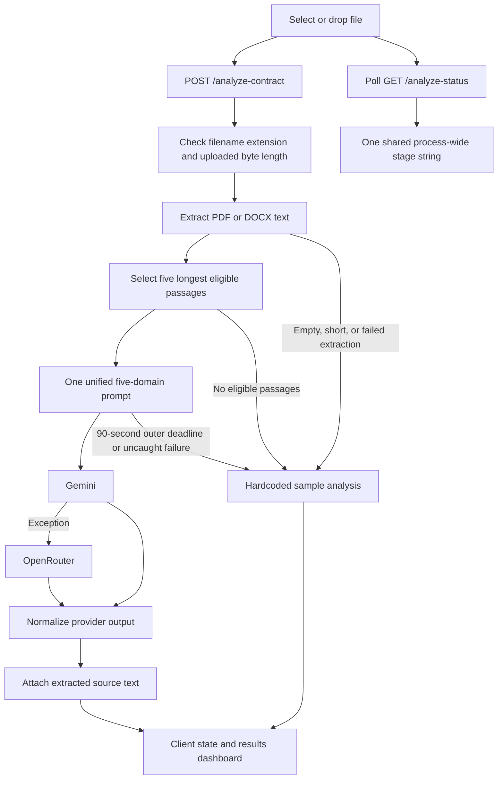

# LEXGUARD project analysis

Reviewed on 27 October 2026 against commit `510b2ff`.

> Historical baseline. Implementation has since changed; see `IMPLEMENTATION_PLAN.md`, `README.md`, and `DEPLOYMENT.md` for the current state.

LEXGUARD is an AI contract-review MVP with a substantial presentation layer and a small, understandable backend. Its active analysis path is one prompt covering five legal domains, with a Gemini-to-OpenRouter provider cascade. The current implementation needs correctness, document handling, and security work before its results can be treated as dependable contract analysis.

This review did not change application code or deployment configuration. It inspected the application, prompts, supporting component library, dependency manifests, deployment files, documentation, and recent commit history, and exercised focused local behavior checks. Production deployments and live AI output quality were not verified.

## 1. Architecture and code map

| Area | Implementation | Main entry points |
| --- | --- | --- |
| Frontend | Next.js 16.2.6 App Router, React 19.2.6 in the lockfile, TypeScript, Tailwind 4, Framer Motion | `lexguard_frontend/app/page.tsx`, `app/layout.tsx` |
| UI | Light pastel glass styling, landing page, upload, analysis overlay, contract viewer, scores, expandable findings | `lexguard_frontend/components/lexguard/` |
| Shared UI library | Radix/shadcn-style controls and utilities; largely outside the active page's import path | `lexguard_frontend/components/ui/`, `hooks/` |
| Backend | FastAPI, Uvicorn, Python | `lexguard_backend/main.py`, `routes/analyze.py` |
| Extraction | `pdfplumber` for text PDFs; ZIP/XML parsing for DOCX | `services/pdf_parser.py` |
| Passage selection | Paragraph splitting, discard passages of 50 characters or fewer, select five longest remaining passages | `services/chunking.py` |
| Active AI orchestration | One prompt containing five domain perspectives | `services/unified_analysis.py`, `prompts/super_agent_prompt.txt` |
| Primary provider | `google.generativeai`, `gemini-2.5-flash`, structured JSON, up to three attempts | `services/gemini_service.py` |
| Secondary provider | OpenRouter HTTP calls through `urllib` in a worker thread; configurable model, default `anthropic/claude-3.5-sonnet` | `services/openrouter_service.py` |
| Output adaptation | JSON cleanup, provider field remapping, fallback values | `utils/helpers.py` |
| Sample fallback | Fixed employment agreement, three fixed findings, fixed scores | `services/mock_fallback.py` |
| Deployment | Vercel frontend configuration and Render backend configuration | `lexguard_frontend/vercel.json`, `lexguard_backend/render.yaml`, `DEPLOYMENT.md` |

The application has one user-facing route, `/`. Navigation between landing, analyzing, results, and error screens uses component state. There is no implemented database, account system, report history, report-specific URL, team workspace, retrieval system, or durable job queue.

The older `services/agent_analysis.py` can run five separate agent calls concurrently, and `services/risk_analysis.py` contains a synthesis function. Neither participates in the active upload route. Their prompts remain in the repository. Changes to those files will not change current upload analysis.

## 2. Actual request flow

The browser sends a multipart upload directly to the backend. Its main request deadline is 100 seconds. The backend's 90-second timeout wraps the provider-analysis call only; it does not cover uploading, parsing, or passage selection. Progress stages are timed simulations, not events emitted by the actual parser or model.

On successful provider analysis, the backend adds `provider_used`, `analysis_duration`, and `fallback_triggered`, then attaches the extracted text. The frontend neither types nor displays those metadata fields. The hardcoded sample fallback omits them entirely.

### API surface

| Endpoint | Current behavior |
| --- | --- |
| `POST /analyze-contract` | Upload and synchronous request/response analysis; no authentication or validated response model |
| `GET /analyze-status` | Returns the same process-wide stage to every caller |
| `GET /health` | Static healthy response; does not verify credentials or provider availability |
| `GET /` | Static service/version information |
| `/docs`, `/redoc`, `/openapi.json` | FastAPI-generated API documentation |

### Configuration

- Frontend backend URL: `NEXT_PUBLIC_API_URL`, then `NEXT_PUBLIC_API_BASE_URL`, then `http://127.0.0.1:8000`.
- Backend: `GEMINI_API_KEY`, `OPENROUTER_API_KEY`, `OPENROUTER_MODEL`, `FRONTEND_URL`, `PORT`, and `HOST`.
- CORS permits localhost, configured frontend origins, and every HTTPS subdomain of `vercel.app`; credentials are enabled.
- `.env` loading uses `override=True`. There are no environment-example files in this checkout, despite setup instructions referring to them.

## 3. Feature inventory

| Feature | Current state |
| --- | --- |
| PDF upload and text extraction | Implemented for text PDFs; no OCR for scanned pages |
| DOCX upload and extraction | Implemented through `word/document.xml`; plain text only |
| Legacy `.doc` | Advertised and accepted, but routed through the PDF parser |
| Risk and fairness analysis | Provider integration implemented; output reliability has the issues below |
| Five legal agents | Five perspectives in the active prompt; separate-agent code is inactive |
| Progress display | Animated frontend and simulated shared backend stages |
| Document viewer | Reconstructed text with substring highlights; does not render the original PDF/Word layout |
| Quote alignment | Client fuzzy matching can replace a model quote with similar source text |
| Clause details | Severity, explanation, impact, negotiation tip, affected party, confidence |
| Counter-proposal | Fixed email template populated with top concerns after a two-second timer |
| PDF export | Browser print dialog and print CSS; no dedicated report-generation service |
| Share report | Shares/copies the current homepage URL; recipients cannot retrieve the analysis |
| Sign In / Get Started in navbar | Controls have no action handlers |
| Watch Demo | Control has no action handler |
| Pricing / How it Works navigation | Anchor links have no corresponding target sections |
| Accounts, history, collaboration, RAG, citations, signatures | Not implemented |

## 4. Findings to address before feature expansion

### P0 — Sample findings are silently presented as an uploaded contract's analysis

**Evidence:** `lexguard_backend/routes/analyze.py:67`, `:84`, and `:97`; `services/mock_fallback.py:3`; `lexguard_frontend/app/page.tsx:202`.

Corrupt PDFs, empty documents, unsupported legacy Word content, provider failures, and analysis timeouts can all produce HTTP 200 with the same sample employment agreement. A valid synthetic service agreement with both provider keys absent returned the sample agreement and its findings. The frontend labels that response with the uploaded filename. There is no response field or visible banner identifying it as sample data. Even the sample's executive summary mentions an arbitration clause absent from its supplied text.

**Next change:** Return explicit extraction/provider errors for real uploads. Make sample analysis a separately selected demo mode. Preserve actual source identity and return a typed status/provenance object consistently.

### P0 — Document text reaches an unsafe HTML rendering path

**Evidence:** `lexguard_frontend/components/lexguard/contract-viewer.tsx:22`, `:58`, and `:129`.

Extracted text and clause values are concatenated into HTML and passed to `dangerouslySetInnerHTML` without escaping. A synthetic DOCX preserved an image tag with an inline event handler through extraction and API response. Rendering the actual viewer with React's server renderer confirmed that it emits this as raw markup. This creates a document-driven cross-site scripting path. No malicious JavaScript was executed during the review.

**Next change:** Render source text as React text nodes with separately constructed highlight elements. Treat model-returned IDs and quotations as untrusted values too.

### P1 — Only a small, length-selected subset of the document is analyzed

**Evidence:** `lexguard_backend/services/chunking.py:14`; `routes/analyze.py:73`.

The selector removes short passages and keeps only five longest eligible passages, regardless of importance. A short uncapped-liability term can disappear while long contextual paragraphs remain. PDF extraction inserts page boundaries, so this often becomes selection of five text-heavy pages. Conversely, an unusually large single passage is not bounded by a token limit. The UI does not disclose partial coverage.

**Next change:** Preserve all material sections, retain page/character locations, use explicit input budgets, analyze bounded batches, and disclose any omitted or unreadable content. Summarization must retain evidence links to original passages.

### P1 — Confidence is incorrectly used as clause risk magnitude

**Evidence:** `lexguard_backend/services/gemini_service.py:9`; `utils/helpers.py:192`.

The active provider clause schema includes confidence and risk level but no numeric clause risk score. When a numeric score is absent, normalization derives it from confidence. A low-severity clause with 95% confidence becomes risk 9/10. Zero confidence is also overwritten with 80 because of truthiness-based defaults. Overall, fairness, breakdown, and confidence values are not consistently bounded.

**Next change:** Define severity, risk magnitude, and confidence separately. Require appropriate score bounds and explicit missing-value handling. Treat confidence as an uncalibrated model estimate until evaluated against labeled examples.

### P1 — Response contracts exist but are not enforced

**Evidence:** `lexguard_backend/models/schemas.py:26`; `routes/analyze.py:42`; `utils/helpers.py:65`; `lexguard_frontend/app/page.tsx:202`.

The Pydantic response classes are not used by the route. Provider `TypedDict` definitions, Pydantic models, and frontend interfaces have divergent fields and severity vocabulary. The client type annotation does not validate JSON at runtime. An invalid top-level array normalizes into an apparently completed empty 50/50 analysis; a percentage-form overall score raises `ValueError`.

**Next change:** Adopt one canonical response contract with enums, bounds, provenance, coverage, and error states; validate before returning and on the client boundary. Generate client types from the API schema where useful.

### P1 — Quote grounding is not validated, and fuzzy alignment can conceal errors

**Evidence:** `lexguard_frontend/components/lexguard/results-dashboard.tsx:36` and `:136`; `lexguard_backend/utils/helpers.py:5`.

The backend does not verify that quoted clauses occur in the analyzed source. The client rewrites quotes using a loose word-overlap match, without validating the associated explanation. A fabricated quote stating that a customer may **not** cancel matched a source sentence stating that the customer **may** cancel. JSON cleanup also alters commas inside otherwise valid JSON string values, potentially changing verbatim quotations.

**Next change:** Parse valid JSON before attempting recovery, validate evidence against source text on the backend, and return source spans. Preserve unmatched findings as explicitly unverified rather than substituting a similar quotation.

### P1 — Progress and background-task lifecycle are unsafe under concurrency

**Evidence:** `lexguard_backend/routes/analyze.py:15`, `:22`, and `:58`.

All requests mutate one global dictionary. A two-request local probe confirmed that request A can set the shared status to `Complete` while B is still awaiting analysis. A new request can also reset an earlier request's progress. Separate server processes have separate dictionaries. Animation tasks are created without retaining handles or cancelling them when the request finishes or fails.

**Next change:** Either show an explicitly indeterminate request-local loader or introduce job IDs and per-job state. Add durable shared state only when deployment/concurrency requirements justify it, and tie task cleanup to request/job lifecycle.

### P1 — Input processing and resource use need explicit limits

**Evidence:** `lexguard_backend/routes/analyze.py:48`; `services/pdf_parser.py:6` and `:23`.

Validation checks the filename extension, then reads the whole uploaded file before enforcing the 10 MiB limit. Both extraction paths perform synchronous work within an async handler. PDF page count, extracted-text length, DOCX decompressed XML size, and parsing time have no explicit bounds. PDF extraction errors can return partial text without a partial-extraction warning. Scanned PDFs become empty extraction and then sample findings. Legacy `.doc` has no parser.

**Next change:** Reject unsupported `.doc` or add a real converter; validate format signatures; bound upload reads, decompression, pages, extraction output, and parser execution; offload blocking extraction; return clear unreadable/scanned/partial states.

### P1 — Application-level abuse and error controls are incomplete

**Evidence:** `lexguard_backend/main.py:34` and `:46`; `routes/analyze.py:42`.

The repository implements no authentication, quota, rate limit, or concurrency budget on the paid analysis endpoint. CORS is not an access-control boundary for direct API clients, and the preview-origin rule trusts unrelated Vercel applications. The global exception handler returns the first 200 characters of the exception despite its comment promising not to expose raw errors. JSON recovery can log provider-output snippets containing contract information. External infrastructure controls were not inspected.

**Next change:** Add appropriate access and usage controls, narrow trusted origins, redact logs, and return stable public errors with internal correlation IDs.

### P1 — Provider time budgets do not guarantee a useful secondary attempt

**Evidence:** `lexguard_backend/services/gemini_service.py:56`; `services/openrouter_service.py:55`; `routes/analyze.py:80`.

Gemini can attempt three calls before OpenRouter begins. OpenRouter can also attempt three calls with 45-second request timeouts, but the whole orchestration has only 90 seconds. A slow primary can consume the entire deadline; a controlled timeout probe confirmed the secondary provider is never called in that case. Cancelling an awaited worker-thread request does not itself terminate the underlying blocking request.

**Next change:** Allocate explicit per-provider deadlines within one end-to-end budget, retry only appropriate failures, reserve time for the secondary, and report failures honestly. The locally installed Google SDK also emits a warning that support for `google.generativeai` has ended; evaluate migration before expanding this integration.

## 5. Other product and maintenance findings

- **Report export can omit findings.** `app/globals.css:531` hides every `.cursor-pointer` element during print; each clause card has that class (`clause-card.tsx:124`). Responsive tab visibility and animation-dependent values also need browser print QA.
- **Interactive accessibility needs attention.** Clause expansion uses a clickable `div` without keyboard semantics; icon-only menu/remove controls lack labels; overlays lack dialog/focus handling. CSS reduced-motion rules exist, but Framer Motion animations and JavaScript counters need separate review.
- **Provider provenance is hidden.** Displaying the actual provider, sample/live status, coverage, and relevant warnings would help users interpret results.
- **Legal context is underspecified.** There is no selected jurisdiction, reviewing party, contract type, or evaluated citation mechanism. No benchmark or labeled evaluation set supports the UI's `98% accuracy` claim. The code does not substantiate provider-side retention/deletion guarantees in the privacy copy.
- **Prompt instructions are not isolated from document instructions.** Contract content is appended to the primary model's prompt. There are no dedicated adversarial-document checks or source-grounding gates. This is a reliability concern; no live prompt-injection evaluation was performed.
- **Client lifecycle cleanup is incomplete.** Polling and request cancellation are handled inside the upload function, without an unmount cleanup; in-flight polling can write a stale stage after completion. Several timers/animation frames also lack complete teardown.
- **Frontend quality gates are incomplete.** `next.config.mjs:4` disables build-time type errors. TypeScript passed independently in this review, but future errors can ship. The lint script refers to ESLint, which is absent from dependencies and has no checked-in configuration.
- **No committed automated tests or CI were found.** Local probes in this review are diagnostic checks, not a maintained regression suite.
- **Backend dependencies are entirely unpinned.** There is no Python lockfile or declared Python runtime version. `typing_extensions` is imported directly but only available transitively. The repository also does not ignore common Python virtual-environment directories.
- **Frontend scaffolding needs cleanup when convenient.** Generic package name `my-project`, inactive base stylesheet, duplicate toast/mobile hooks, broad unused UI components/dependencies, and tracked `tsconfig.tsbuildinfo` add maintenance noise. Inspect import usage before removing anything.
- **Documentation needs reconciliation.** README describes PyPDF2/python-docx/HTTPX, but active code uses pdfplumber/ZIP-XML/urllib. It describes React 19.0.0, while the lockfile resolves 19.2.6. It recommends Node 18+, while the locked Next.js package requires Node >=20.9.0. Referenced `.env.example`, `data/`, and MIT `LICENSE` files are absent. Uptime, accuracy, full coverage, and live-health claims were not established by this review.

## 6. Verification performed

| Check | Result and scope |
| --- | --- |
| Frontend dependency install | `npm ci --ignore-scripts --no-audit --no-fund` succeeded using the committed lockfile |
| Production frontend build | `npm run build` passed once network access allowed Google Fonts downloads; output prerenders `/` and `/_not-found` |
| TypeScript | `./node_modules/.bin/tsc --noEmit --incremental false` passed independently |
| Lint | `npm run lint` failed: `eslint: command not found` |
| Backend syntax/imports | All 12 Python source files parsed; FastAPI app imported and registered its routes |
| Local startup/HTTP | Built frontend served HTTP 200 with expected landing content; backend `/health` served HTTP 200 |
| Extraction | Valid synthetic PDF and DOCX fixtures produced expected text |
| Upload errors | Unsupported extension returned 400; over-limit upload returned 413 |
| Failure behavior | Corrupt PDF, legacy DOC input, blank DOCX, and missing-provider-key paths returned unmarked HTTP 200 sample analyses |
| Successful route shape | A stubbed provider result received the actual extracted source text |
| Output consistency | Reproduced confidence/risk conflation, zero-confidence replacement, unbounded scores, invalid-output acceptance, percentage-score failure, JSON-string alteration, and loss of short material clauses |
| Concurrency/deadlines | Reproduced shared-status completion while another request runs and primary deadline exhaustion before any secondary call |
| Viewer/quote alignment | Server-rendered the real viewer to confirm raw HTML injection; ran the actual fuzzy-match function against a quote with inverted meaning |
| Interactive browser | Not completed: browser-tool inventory returned no connected browsers |
| Live providers/production | Not exercised; placeholder keys and synthetic content prevented real model calls and charges |

The focused behavior probes made 27 assertions confirming current behavior, including defects. They do not constitute 27 passing product requirements or establish legal-analysis accuracy. Local backend checks used the installed Python 3.14.3 environment; they do not prove reproducibility from a clean Python dependency installation. No vulnerability audit, production configuration audit, load test, mobile rendering test, or OCR evaluation was performed.

## 7. Suggested implementation sequence

1. **Make results trustworthy at the boundary.** Remove silent sample fallback from real uploads, fix unsafe HTML rendering, enforce a canonical response contract, separate confidence from risk, and add regression checks for these reproduced failures.
2. **Make extraction and analysis complete enough to describe accurately.** Correct format support, enforce resource limits, preserve page/spans, disclose coverage, validate quoted evidence, and allocate provider deadlines deliberately.
3. **Make concurrent use reliable.** Replace shared progress, clean up task/request lifecycles, add usage controls and structured redacted diagnostics, pin dependencies, and restore lint/type/build gates in CI.
4. **Finish existing product promises.** Repair navigation, make demo mode explicit, fix print export, decide whether reports should persist before implementing share links, and either label the email as a template or implement generation.
5. **Then expand capability.** Add reviewing-party/jurisdiction context and an evaluation dataset before building clause rewriting, report history/accounts, workspaces, or retrieval. Add storage only with an explicit report-retention and privacy design.

The first implementation task should address the two P0 findings and response validation together. That creates a stable base for further feature work while keeping the existing frontend and backend structure.
