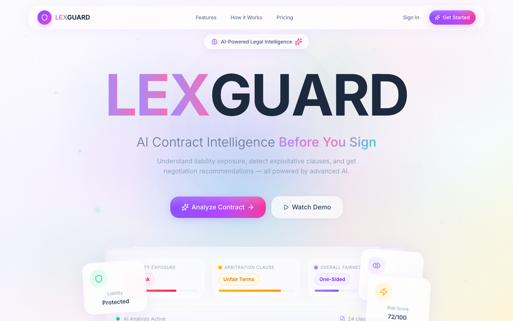
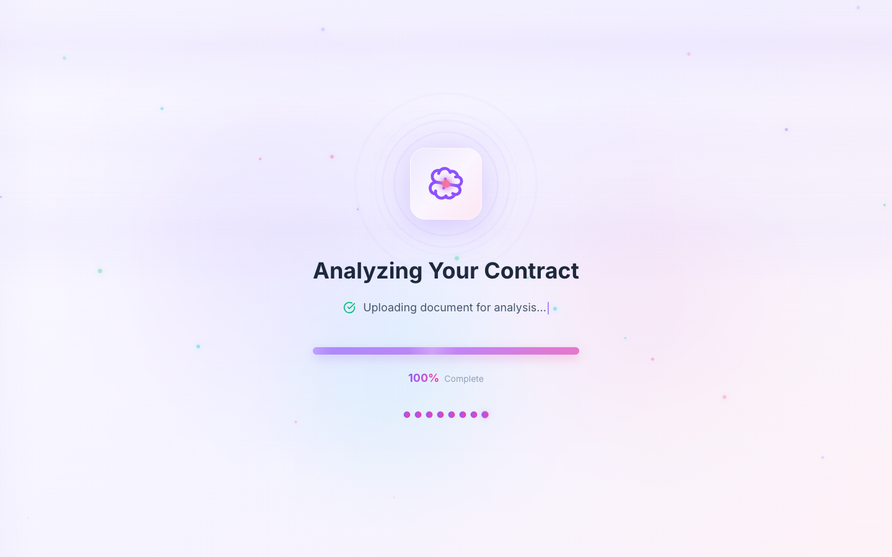
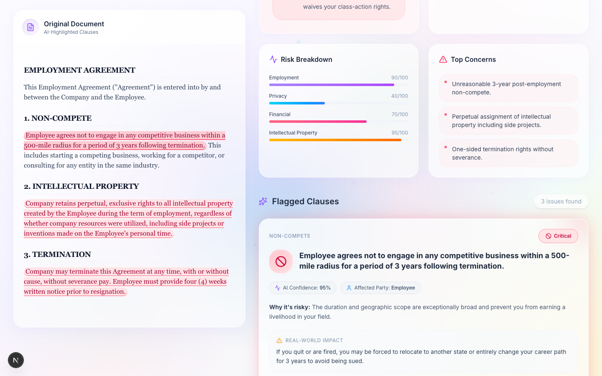
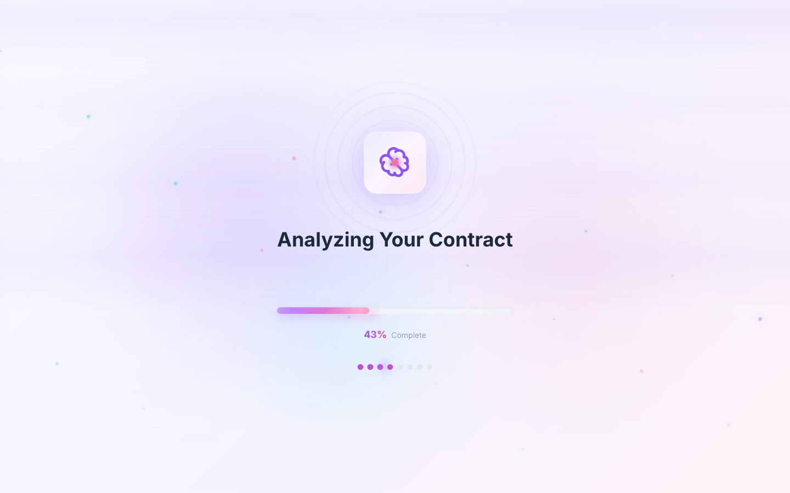
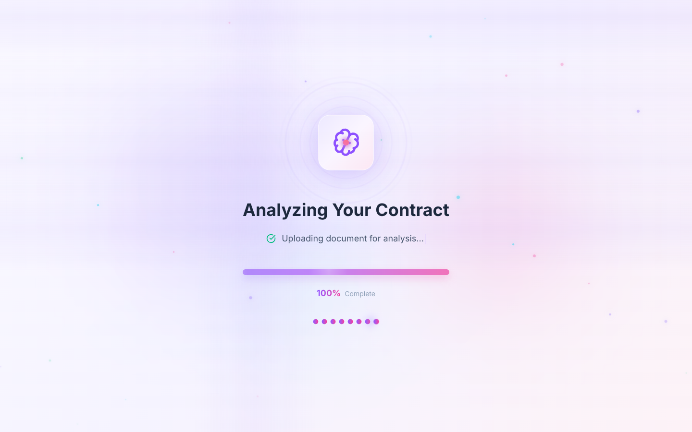

<p align="center">
  
</p>

<h1 align="center">🛡️ LEXGUARD — AI Contract Risk Intelligence System</h1>

<p align="center">
  <strong>Understand the fine print. See the risks. Prepare your next conversation.</strong>
</p>

<p align="center">
  <a href="https://lexguard-frontend-seven.vercel.app/">
    
  </a>
  <a href="https://drive.google.com/file/d/1AtPFyL2P54Hh2dFmx7QJNom6dRRytfBU/view?usp=drive_link">
    
  </a>
  <a href="https://lexguard-backend-w5k1.onrender.com/health">
    
  </a>
  <a href="https://github.com/raghav-shell/Lexguard/actions">
    
  </a>
</p>

<p align="center">
  
  
  
  
  
</p>

<p align="center">
  LEXGUARD turns complex PDF and DOCX agreements into a source-linked contract review. Explore potential risks, understand their possible impact, and prepare practical negotiation questions — with the original wording always within reach.
</p>

<p align="center">
  <a href="https://lexguard-frontend-seven.vercel.app/"><strong>Try the app</strong></a> ·
  <a href="https://drive.google.com/file/d/1AtPFyL2P54Hh2dFmx7QJNom6dRRytfBU/view?usp=drive_link"><strong>Watch the demo</strong></a> ·
  <a href="https://github.com/raghav-shell/Lexguard"><strong>Source code</strong></a> ·
  <a href="./DEPLOYMENT.md"><strong>Deployment guide</strong></a>
</p>

---

## ⚖️ Why LEXGUARD?

An employment offer, freelance agreement, or supplier contract can hide broad liability, restrictive obligations, ownership transfers, or unequal termination rights in language that is difficult to unpack. Reviewing that wording without structure makes important questions easy to miss.

**LEXGUARD helps people approach those decisions with more understanding.** Upload an agreement, add your perspective, and receive plain-language findings linked to the exact clauses behind them. Each finding explains why a term may matter and offers a starting point for negotiation.

### Who is it for?

- **Freelancers and consultants** reviewing payment terms, liability, and ownership of their work.
- **Employees** reading employment offers, restrictions, and termination provisions.
- **Founders and small businesses** preparing questions about service, supplier, and subscription agreements.

AI-assisted review supports informed discussion. It does not replace qualified legal advice or determine whether a clause is enforceable.

---

## 📌 Highlights

- 📄 **PDF & DOCX review:** Upload a searchable document and optionally add your role, jurisdiction, and contract type.
- 🔍 **Evidence you can inspect:** Findings include exact quotations, verified source locations, plain-English explanations, and possible impacts.
- ⚖️ **Five review perspectives:** Employment, privacy, financial exposure, intellectual property, and fairness.
- 🤝 **A practical next step:** Use clause-specific negotiation suggestions to prepare an editable email template.
- 📤 **Reports you can keep:** Download Markdown or JSON, or print/save a PDF with every finding.
- 🛡️ **A guarded analysis pipeline:** Bounded document parsing, complete accepted-text coverage, structured validation, provider fallback, and clear error states.

---

## 🖼️ Screenshots

These screenshots show an earlier interface and illustrate the project's original visual presentation. They do not represent the latest local design preview.

| 📊 Review Dashboard | 🔍 Contract Analysis |
| :---: | :---: |
|  |  |
| **⚡ Review in Progress** | **🤝 Risk Highlights** |
|  |  |

---

## ✨ Core Features & Workflows

### 1. Review your agreement

Upload a searchable PDF or DOCX and supply optional context. The backend extracts the document text, reviews every accepted section, validates the model output, and checks each quotation against the source. Loading, cancellation, and actionable errors are part of the flow.

### 2. Understand the findings

Search findings, filter by domain or severity, and inspect potential risks alongside their source wording. Expand a finding for its possible real-world impact, affected party, and negotiation suggestion. Risk and confidence scores are estimates to interpret with the evidence.

### 3. Prepare for negotiation

Turn the report's suggestions into an **editable email template**. Review and adapt it before copying or downloading. This is a template based on the findings, rather than a separately generated legal redline.

### 4. Take the review with you

Export a readable Markdown report, download structured JSON, or print/save a complete PDF report. Print output includes every finding even when screen filters are active or details are collapsed.

**Want to explore first?** Select **Explore a sample** on the landing page. Sample mode is explicitly labeled and uses an included agreement. Failed real reviews show an error; they never substitute sample findings.

---

## 🧠 Contract Intelligence Pipeline

LEXGUARD uses **one structured model review per text section**, covering five domains. These are review perspectives within the analysis, rather than five independently executing agents.

```text
                  ┌───────────────────────────────┐
                  │  PDF / DOCX + reviewer context │
                  └───────────────┬───────────────┘
                                  ▼
                  ┌───────────────────────────────┐
                  │  Bounded extraction & batching│
                  │  All accepted text included   │
                  └───────────────┬───────────────┘
                                  ▼
                  ┌───────────────────────────────┐
                  │     Structured AI review      │
                  │ Employment · Privacy · Finance│
                  │ Intellectual property         │
                  │ Fairness                      │
                  └───────────────┬───────────────┘
                                  ▼
                  ┌───────────────────────────────┐
                  │ Schema & quotation validation │
                  │ Source offsets & score merging│
                  └───────────────┬───────────────┘
                                  ▼
                  ┌───────────────────────────────┐
                  │  Interactive report workspace │
                  │  Findings · Evidence · Exports│
                  └───────────────────────────────┘
```

| Perspective | What the review looks for |
| --- | --- |
| 💼 Employment | Restrictions, notice periods, working obligations, and termination terms |
| 🔒 Privacy | Data collection, sharing, consent, and related obligations |
| 💸 Financial | Payment terms, penalties, indemnities, and liability exposure |
| 💡 Intellectual property | Ownership, assignment scope, and pre-existing work |
| ⚖️ Fairness | One-sided rights, remedies, dispute terms, and bilateral balance |

Document validation, isolated parsing, section batching, evidence verification, conservative score aggregation, generated client schemas, and exports provide application logic around the provider calls.

### Provider fallback

```text
Gemini 2.5 Flash → Configured OpenRouter fallback → Validated report
                              │
                   No valid provider response
                              ▼
                    Clear, retryable error
```

The primary model is configurable through `GEMINI_MODEL`; the fallback uses `OPENROUTER_MODEL` and requires structured-output support. Fallback availability depends on provider configuration, quota, and billing. The app does not promise uninterrupted service or fabricate a report when providers fail.

---

## 📁 Project Structure

```text
Lexguard/
├── assets/                       # Project banner
├── screenshots/                  # Earlier interface screenshots
├── lexguard_frontend/
│   ├── app/                      # Pages, layout, and same-origin API proxy
│   ├── components/lexguard/      # Upload, findings, source viewer, and report
│   ├── lib/                      # Generated schema, validation, and exports
│   ├── tests/                    # Vitest and Testing Library coverage
│   └── public/                   # Static assets and icons
├── lexguard_backend/
│   ├── models/                   # Canonical Pydantic response models
│   ├── prompts/                  # Structured review instructions
│   ├── routes/                   # Contract-analysis endpoint
│   ├── services/                 # Parsers, batching, providers, and analysis
│   ├── scripts/                  # Client contract generation
│   ├── tests/                    # Backend regression coverage
│   ├── security.py               # Service authentication and admission limits
│   └── main.py                   # FastAPI entry point and health endpoints
├── docs/                         # Verification, evaluation, submission notes
├── .github/workflows/ci.yml       # Automated quality checks
└── DEPLOYMENT.md                  # Production configuration and release guide
```

---

## 🛠️ Tech Stack

| Layer | Technologies |
| --- | --- |
| **Frontend** | Next.js 16 App Router, React 19, TypeScript, Tailwind CSS 4 |
| **UI & interaction** | Radix UI, Lucide React, Framer Motion |
| **Backend** | Python, FastAPI, Uvicorn, asynchronous HTTPX |
| **Document processing** | pdfplumber for PDF; ZIP/XML parsing with defusedxml for DOCX; isolated parser processes |
| **AI integration** | Gemini REST API and optional OpenRouter fallback |
| **Validation** | Pydantic models and generated Zod client validation |
| **Quality** | Python unittest, Vitest, Testing Library, ESLint, TypeScript, dependency advisory scans |
| **Hosting** | Vercel frontend, Render backend, GitHub Actions |

---

## 💻 Local Development Setup

### Prerequisites

- **Node.js 24 LTS**, as recorded in `lexguard_frontend/.nvmrc`.
- **Python 3.13**, as recorded in `lexguard_backend/.python-version`.
- A Gemini and/or OpenRouter API key for real analysis. The sample report works without provider credentials.

### 1. Start the backend

```bash
git clone https://github.com/raghav-shell/Lexguard.git
cd Lexguard/lexguard_backend

python3 -m venv .venv
source .venv/bin/activate
# Windows PowerShell: .venv\Scripts\Activate.ps1

pip install -r requirements.txt
cp .env.example .env
# Add your provider credentials to .env before starting real reviews.
python main.py
```

### 2. Start the frontend

In another terminal, from the repository root:

```bash
cd lexguard_frontend
npm ci
cp .env.example .env.local
npm run dev
```

Open **[http://localhost:3000](http://localhost:3000)**. The backend runs on port 8000 by default.

---

## ⚙️ Environment Configuration

Use the committed `.env.example` files as the complete templates. The values below are placeholders for local development.

**Backend — `lexguard_backend/.env`:**

```env
ENVIRONMENT=development
GEMINI_API_KEY=your_gemini_api_key
GEMINI_MODEL=gemini-2.5-flash
OPENROUTER_API_KEY=
OPENROUTER_MODEL=anthropic/claude-sonnet-4.6
ANALYSIS_API_KEY=
FRONTEND_URL=http://localhost:3000,http://127.0.0.1:3000
HOST=127.0.0.1
PORT=8000
```

**Frontend — `lexguard_frontend/.env.local`:**

```env
BACKEND_API_URL=http://127.0.0.1:8000
ANALYSIS_API_KEY=
```

The browser calls `/api/analyze-contract` on the Next.js server, which forwards to the backend. `BACKEND_API_URL` and `ANALYSIS_API_KEY` are **server-only**; do not prefix the service key with `NEXT_PUBLIC_`. If you enable a service key locally, use the same value on both servers. Production requires a random key of at least 32 characters.

---

## ⚡ API Endpoints

| Method | Endpoint | Purpose |
| :---: | --- | --- |
| `POST` | `/api/analyze-contract` | Browser-facing Next.js proxy for document review |
| `POST` | `/analyze-contract` | FastAPI upload, extraction, review, and source-verified response; requires the service key when configured |
| `GET` | `/health` | Backend liveness; does not test the AI provider |
| `GET` | `/ready` | Checks whether a provider key is configured; does not probe provider connectivity |
| `GET` | `/` | Backend service name and API version |

---

## 🔒 Limits, Security & Data Handling

- **Web uploads:** searchable PDF or DOCX, up to **4 MiB**. Legacy `.doc` is not supported; scanned documents need OCR first.
- **Backend bounds:** 10 MiB upload limit, 80 PDF pages, 80,000 extracted characters, 10-second parser deadline, and 160-second analysis deadline. Over-limit documents are rejected rather than silently truncated.
- **Evidence and scoring:** quotations are checked against the source. Overall risk uses the highest section/finding risk, domain risk the highest section score, and fairness the lowest section score. These are conservative estimates, not measured legal accuracy.
- **Scope:** images, layout, embedded files, and legal enforceability are not established. DOCX extraction covers body/table text with warnings about other areas; accept/reject tracked changes before upload. Cross-section references can still affect interpretation.
- **Access controls:** server-only service authentication, explicit trusted origins, bounded concurrency/quotas, no-store reports, and redacted diagnostics. CORS is not authentication.
- **Data handling:** extracted text goes to the configured AI provider and may go to the fallback; their retention terms apply. Multipart processing may use temporary files, which are closed after processing. Application logs omit contract bodies.
- **Session-based use:** there are no user accounts, saved report history, team workspaces, or enabled analytics. Reports remain in the current browser view until leaving/reloading. Downloaded reports contain contract content; only upload documents you’re authorized to process.

---

## 🚀 Production Deployment

| Service | Host | Root directory | Required configuration |
| --- | --- | --- | --- |
| **Frontend** | [Vercel](https://lexguard-frontend-seven.vercel.app/) | `lexguard_frontend` | `BACKEND_API_URL` and matching server-only `ANALYSIS_API_KEY` |
| **Backend** | [Render](https://lexguard-backend-w5k1.onrender.com/) | `lexguard_backend` | `ENVIRONMENT=production`, `ANALYSIS_API_KEY`, and provider credentials |

**Build commands:** `npm ci` / `npm run build` for the frontend; `pip install -r requirements.txt` for the backend.

**Backend start command:**

```bash
uvicorn main:app --host 0.0.0.0 --port $PORT --workers 1 --limit-concurrency 20
```

Use **one backend worker on one instance** with the current in-memory quota/concurrency controls. Distributed admission controls are needed before horizontal scaling. Environment changes require a new deployment.

**Recorded verification — 28 October 2026:** synthetic PDF and DOCX reviews through the public app returned genuine Gemini reports with complete extracted-text coverage and exact source-linked findings. OpenRouter returned a quota/billing error during that verification. See [the verification record](./docs/VERIFICATION.md) for the scope and remaining checks; this is a dated result, not a live health guarantee.

For configuration, secrets, capacity limits, and release checks, see **[📋 DEPLOYMENT.md](./DEPLOYMENT.md)**.

---

## ✅ Tests & Quality Checks

Run from the repository root with the backend virtual environment active:

```bash
python3 -m unittest discover -s lexguard_backend/tests -v
python3 lexguard_backend/scripts/generate_contract.py --check

cd lexguard_frontend
npm test
npm run typecheck
npm run lint
npm run build
```

After changing response models, regenerate the client contract with `python3 lexguard_backend/scripts/generate_contract.py`. CI checks schema drift, backend/frontend tests, lint, types, builds, and dependency advisories. Production builds use Webpack.

---

## 🔮 Future Roadmap

These are planned directions, not features available in the current app:

- 📝 **Clause rewriting:** reviewed counter-clause suggestions and document revision workflows.
- 🌐 **Multilingual review:** evaluate supported languages against representative legal documents.
- 👥 **Accounts & team workspaces:** authenticated history, ownership controls, sharing, and collaboration.
- 🧠 **Legal memory:** retrieval over authorized contract history and reusable review preferences.
- 📜 **Regulatory references:** jurisdiction-aware citations with verifiable sources.
- 📄 **OCR support:** extraction and quality checks for scanned agreements.
- ✍️ **E-signature integrations:** a separate, explicitly authorized signing workflow.

The current hardening work is tracked in [IMPLEMENTATION_PLAN.md](./IMPLEMENTATION_PLAN.md). [PROJECT_ANALYSIS.md](./PROJECT_ANALYSIS.md) records the original baseline. See [model evaluation](./docs/EVALUATION.md) and [submission readiness](./docs/SUBMISSION_READINESS.md) for supporting project documentation.

---

## 📄 License

No license file is currently included. The repository owner should choose and add a license before offering the project under a specific license.
